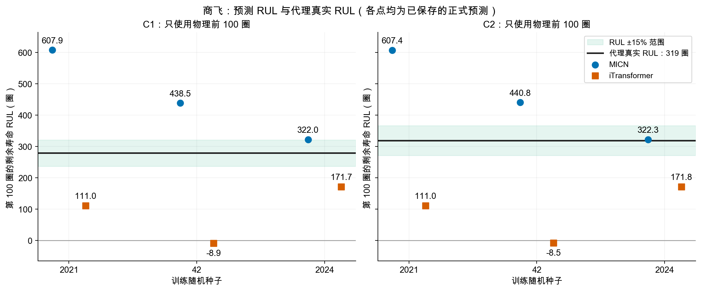
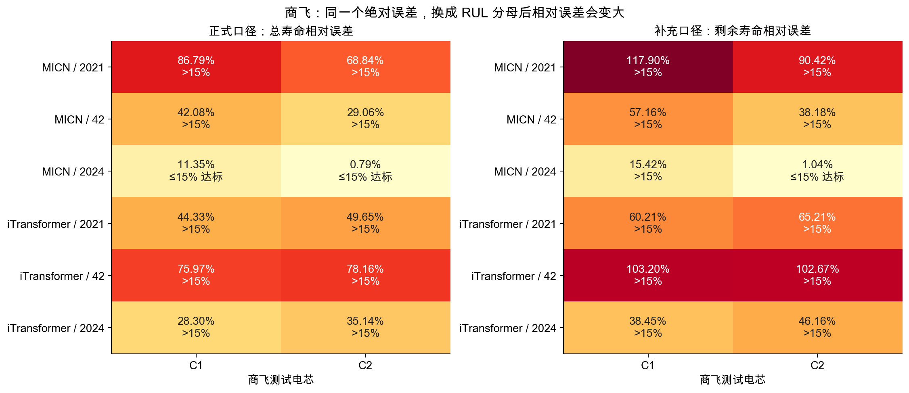
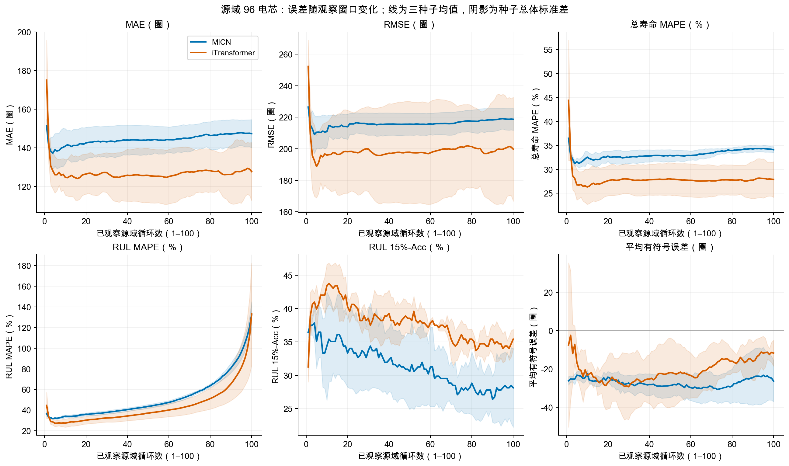
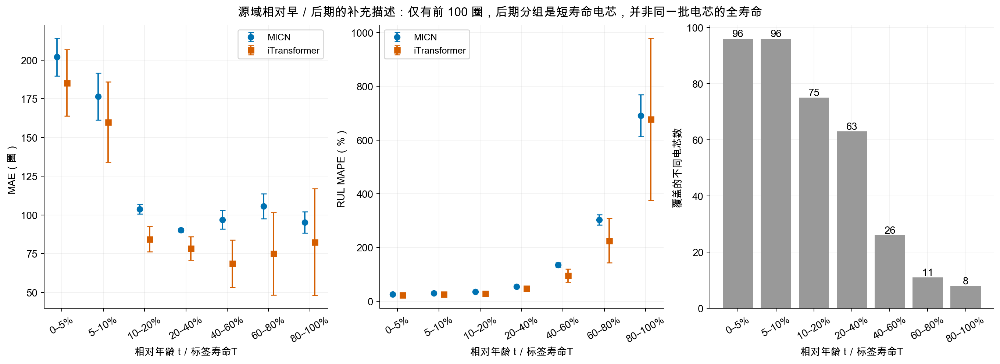
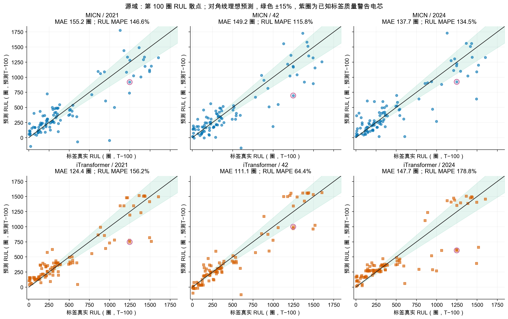
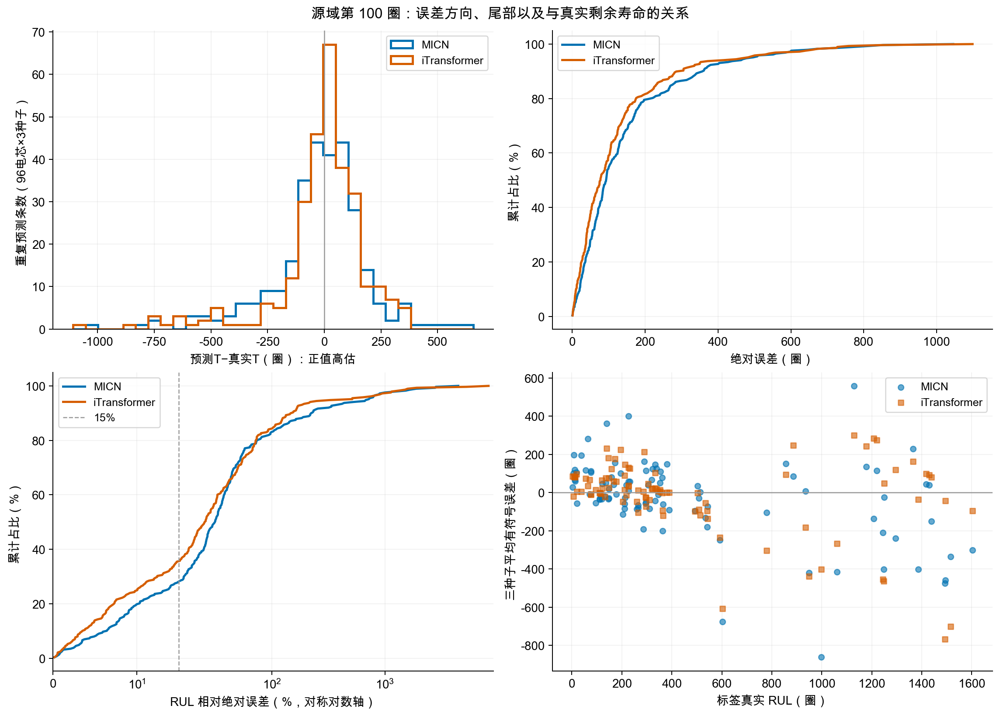
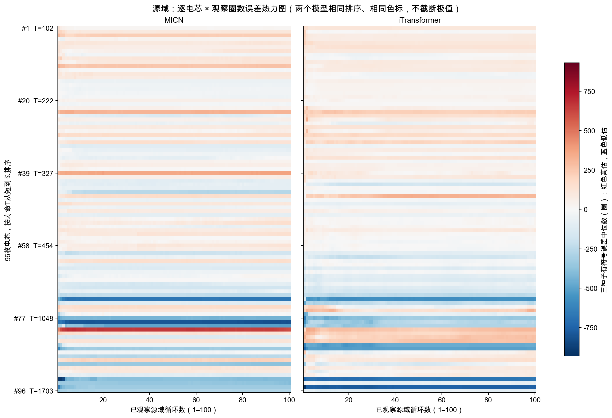
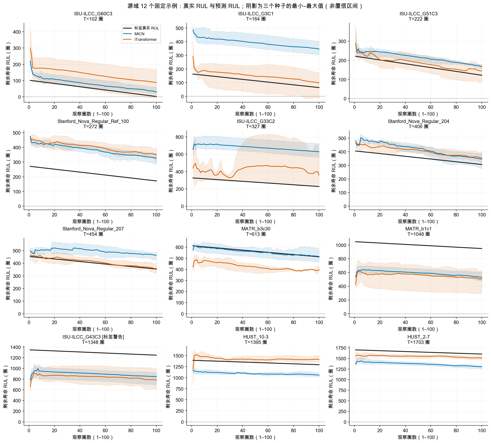
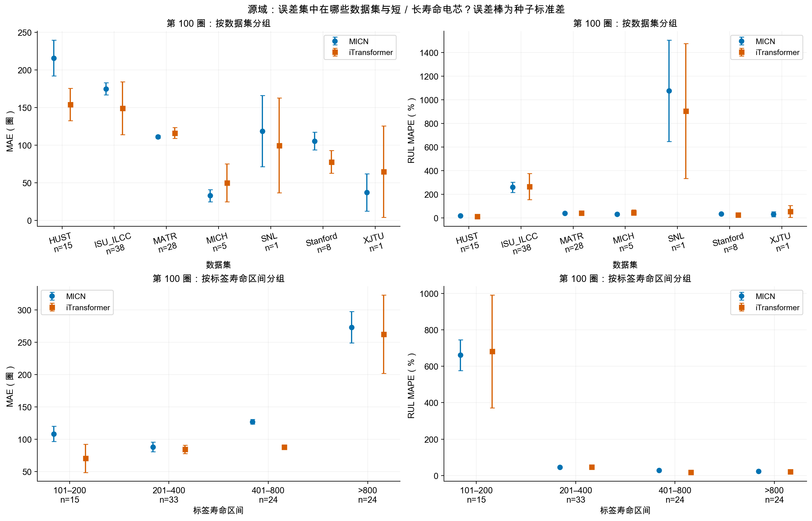

# MICN 与 iTransformer：方法说明与 RUL 可视化分析

本分析只读取已经通过最终审计的预测，不重新训练、不重新选择 checkpoint、不新增商飞推理、不改变任何正式成绩。输出包括 9 张 PNG、9 张可编辑 SVG 和 [完整绘图统计 JSON](analysis.json)。

## 先说结论

- **源域测试集上，iTransformer 更好；商飞 C1/C2 上，MICN 更好。**源域同域成绩不能直接代表商飞的跨域成绩。
- 商飞上 MICN 的 6 条预测全部高估寿命，iTransformer 的 6 条预测全部低估寿命。MICN seed=2024 最接近标签，但这不能作为用商飞结果反选种子的依据。
- 在源域相同 96 枚电芯的前 1–100 圈内，MICN 的绝对误差略增，iTransformer 大体稳定。不能据此说模型在电池真正寿命后期一定恶化：我们没有全寿命滚动预测。
- 第 100 圈附近 **RUL 百分比误差**上升明显，其中重要原因是短寿命电芯的剩余寿命接近零，而不是绝对误差同等幅度地变大。
- 商飞目前只有“观察完前 100 个物理循环”的单点预测。因此不能用这些数据画出商飞真实的逐圈预测曲线，也不能判断商飞真正寿命后期的误差。

## 1. MICN 是什么方法？

MICN 是 ICLR 2023 的通用时间序列方法，不是 BatteryLife 原创的电池物理模型。它的核心是**用不同尺度的卷积，同时处理局部变化和较大范围的关联**。原方法先将序列分成平滑趋势与剩余波动，再用下采样卷积提取局部模式、isometric convolution 建模全局关联，最后融合不同尺度。[MICN 作者代码与架构说明](https://github.com/wanghq21/MICN)

可以把它理解成：观察曲线时既看“某一小段发生了什么”，又看“整个序列的大致模式”，将这些信息合起来做预测。所谓趋势、波动是神经网络中的数学分解，不等于已经识别了某种明确的电池衰减机理。

### 本次 BatteryLife 的具体实现

对应 [models/MICN.py](../../models/MICN.py)，不是直接照搬 MICN 原论文的多步时间序列预测任务：

1. 输入形状为 `B × 100 × 3 × 300`。每圈包括电压、电流、容量三个通道；充电、放电各 150 个重采样点。
2. 把 100 圈的曲线串成 `B × 30000 × 3` 的长序列。这里的一步是重采样曲线点，不是“一圈 SOH”。
3. 以移动平均窗口 13、17 做趋势/波动分解；嵌入至 256 维；经过两个 MIC 模块，每个模块有卷积核 12、16 两个尺度的分支，并有上采样、残差和尺度融合。
4. 将处理后的特征与趋势相加，经 GELU 等处理后展平；最终线性回归层形状为 `1 × 90000`，输出**一个标准化的 95% 阈值总寿命**，再用源域训练集 scaler 还原为圈数。
5. 当前实现共有 **9,016,212 个参数**。这里参数数目仅用于解释模型，不是性能优劣的证据。

**需要区分“原 MICN 原理”与“本仓库的实际实例”：**

- 本轮保留仓库的 `seq_len=1`、`pred_len=5`，但寿命分支实际输入展平长度为 30000。代码依据前两个参数计算 isometric 卷积核，结果两个分支的核都是 **1**。因此不能把本次模型描述成与原 MICN 时间序列预测配置完全一样的全局卷积；最终展平回归层仍会混合整个输入范围的信息。这是原仓库配置和实现的行为，不是本次为了商飞新增的改动。
- 实际 MIC 模块数由 `d_layers=2` 决定，不能把 `e_layers=4` 当作四个 MIC 模块。此分支也不使用注意力，传入的 `n_heads=4` 不是四头注意力；`d_ff=64` 不能等同于模块中实际前馈宽度。
- 虽然配置 `dropout=0`，MIC 子模块内部仍有写死的 **0.05 dropout**。本实验原样保留，没有偷偷修改。
- 模型本身的 mask 处理代码被原仓库注释；不可见曲线已由原 collate/目标适配流程置零。没有将第 101 圈以后信息送入模型。

### 与 iTransformer 的直观区别

iTransformer 将“变量”作为 token，注意力侧重不同变量之间的关系，而不是把每个时间点作为一个 token。[iTransformer 原论文](https://arxiv.org/abs/2310.06625)

本次 [models/iTransformer.py](../../models/iTransformer.py) 将同样的 `30000 × 3` 输入变为 3 个 token，分别对应电压、电流、容量；每个变量的 30000 个点映射到 128 维，再经过 6 个 Transformer 编码层、8 头注意力，最终以 `1 × 384` 的线性层回归一个总寿命。共有 **4,635,649 个参数**。它不是读取 SOH 曲线后直接拟合 RUL，而是从充放电曲线特征学寿命。

## 2. 图中的真实 RUL 与预测 RUL 怎样计算？

本次两个模型直接预测的是寿命阈值圈号 `T95`，不是整条 RUL 曲线。对于已经观察至第 `t` 圈的窗口：

```text
标签真实 RUL(t) = T95 − t
预测 RUL(t)     = 模型依据前 t 圈输出的总寿命 − t
有符号误差     = 预测总寿命 − 标签总寿命
RUL 相对误差   = |预测总寿命 − 标签总寿命| / (T95 − t)
总寿命相对误差 = |预测总寿命 − 标签总寿命| / T95
```

因此总寿命与 RUL 的 **MAE、RMSE 完全相同**，但 MAPE 和百分比达标率不同。曲线上的真实 RUL 是“已知标签减去当前圈数”，不是额外测得的一个 SOH/RUL 传感器读数。

商飞第 100 个物理循环处，C1 的代理真实 RUL 是 **279 圈**，C2 是 **319 圈**。379/419 是日常放电容量 `÷0.94÷183` 的首次 95% 阈值圈号，不是完整 RPT 实测的寿命终点；图中明确称为代理标签。

源域图则使用原 95% 容量寿命标签。源域横轴是前处理记录的观察前缀数，保留原加载器定义；不能将所有源数据的记录索引未经核实都宣称为原始物理全局圈号。

## 3. 商飞结果：只有第 100 圈的真实预测点



黑线是标签剩余寿命；蓝点 MICN，橙色方点 iTransformer。绿色区域是**剩余寿命**的 ±15%，不是正式总寿命的 ±15%。

| 模型 | 随机种子 | C1 预测 RUL / 真实 279 | C2 预测 RUL / 真实 319 |
|---|---:|---:|---:|
| MICN | 2021 | 607.95 | 607.44 |
| MICN | 42 | 438.48 | 440.78 |
| MICN | 2024 | 322.02 | 322.31 |
| iTransformer | 2021 | 111.00 | 110.99 |
| iTransformer | 42 | −8.94 | −8.51 |
| iTransformer | 2024 | 171.73 | 171.76 |

负 RUL 表示模型预测的阈值总寿命已经早于观察结束的第 100 圈，是不符合“该电芯此时尚未到阈值”这一事实的输出；图表和指标都保留它，没有截成零。

| 商飞三种子指标均值 | MICN | iTransformer |
|---|---:|---:|
| MAE（圈，总寿命与 RUL 相同） | 157.49 | 207.66 |
| RMSE（圈，各种子先算再平均） | 160.58 | 208.75 |
| 正式总寿命 MAPE | 39.82% | 51.93% |
| 正式总寿命 15%-Acc | 33.33% | 0.00% |
| 补充 RUL MAPE（第100圈） | 53.35% | 69.32% |
| 补充 RUL 15%-Acc（第100圈） | 16.67% | 0.00% |



MICN seed=2024 的 C1 误差是 43.02 圈：总寿命口径为 `43.02/379=11.35%`，RUL 口径为 `43.02/279=15.42%`。因此它符合原来报告中的总寿命 ≤15%，但不符合剩余寿命 ≤15%。C2 在两种口径下均符合。

六条预测是 **2 枚电芯 × 3 次重复训练**，不能当作六枚独立电芯。两个模型在每个种子下对 C1/C2 的预测都非常接近，而两个标签相差 40 圈；这说明在这两枚测试电芯上输出区分较小，不能推广为模型一定忽略了输入，也不能从两个电芯推断普遍的跨域规律。

## 4. 误差是早期大还是后期大？

### 同一批源域电芯：观察窗口 1–100



图中的六种指标同时展示绝对误差、相对误差、方向。主线是先对 96 枚电芯计算各种子的指标，再取三个种子的均值；阴影是种子总体标准差，不是统计置信区间。

| 模型 | 观察1–20圈 MAE | 观察81–100圈 MAE | 1–20圈总寿命MAPE | 81–100圈总寿命MAPE |
|---|---:|---:|---:|---:|
| MICN | 141.06 圈 | 147.25 圈 | 32.32% | 34.23% |
| iTransformer | 129.25 圈 | 127.50 圈 | 28.24% | 27.87% |

这是五个固定观察阶段的描述性比较，没有根据结果寻找“最佳阶段”。最初只有一两圈信息时波动比较大；此后 MICN 绝对误差略增，iTransformer 基本稳定。**更多早期输入不保证这个已训练模型一定更准**，但这里只能判断前100圈观察范围，不能宣称全寿命后期的结果。

### 为什么 RUL MAPE 会明显升高？

源域第 100 圈 RUL MAPE 为 MICN **132.32%**、iTransformer **133.11%**。这不是原正式报告的总寿命 MAPE（34.11%、27.89%），而是新增的 RUL 分母口径。

源域有 15 枚电芯总寿命在 101–200 圈，其中最短的标签为 102 圈，第100圈只剩2圈。它们贡献了源域第100圈全部 RUL 相对误差和的 **78.14%（MICN）/80.02%（iTransformer）**。另外81枚的 RUL MAPE 描述性均值分别为 **34.28% /31.52%**。这只是解释分母效应的分组统计，**没有排除这些短寿命电芯、更改正式指标**。

举例：总寿命102圈，当前100圈，预测总寿命122圈，误差20圈；总寿命相对误差约19.61%，但剩余寿命相对误差为 `20/2=1000%`。接近寿命终点时应把 MAE、RMSE 与百分比误差一起看。

### 真正相对寿命早／后期的补充分组



以 `t/T95` 分组。寿命进度80–100%只覆盖8枚短寿命电芯、91个电芯窗口；0–5%则覆盖全部96枚。**不同组的电芯组成不同，且不是所有电芯都观察到了寿命后期**，不能直接将两组差异解释成同一批电芯的时间演化。

商飞 C1/C2 在第100圈分别处于标签寿命约26.39%、23.87%的位置。本次没有它们中后期的滚动模型输入与预测，因此商飞早／后期失效位置还不能下结论。

## 5. RUL 预测与标签散点、误差分布



每个面板96枚电芯，三个种子分开画；对角线表示理想预测，绿色区域是 RUL ±15%；紫色圈标注保留在正式测试中的 `ISU-ILCC_G43C3.pkl` 标签质量警告电芯。源域第100圈 MAE 为 MICN **147.38**、iTransformer **127.72** 圈，iTransformer 更优；商飞的顺序相反。



- 左上：有符号误差直方图，负值低估，正值高估。
- 右上：绝对误差的经验累计分布，越靠左越好。
- 左下：RUL 相对误差的经验累计分布，对称对数坐标仅展示非负区间，保留所有极值。
- 右下：每枚电芯的三种子平均偏差与真实RUL的关系，仅作可视化摘要，不替代逐种子正式成绩。

源域第100圈平均偏差为 MICN **−26.36**、iTransformer **−11.77** 圈；商飞则是 MICN **+157.49**、iTransformer **−207.66** 圈。源域和目标域的误差方向与幅度明显不同，但当前结果不能单独证明是容量、工况、化学体系等哪一因素造成。

## 6. 逐电芯热力图与固定示例 RUL 曲线



每行一枚电芯，按标签寿命从短到长排序，横轴是观察1–100圈。左右模型使用相同排序和相同色标，所有极值保留。图像摘要采用三种子有符号误差中位数，避免把某个种子当作全部结果；正式指标仍使用每个种子的原始预测。

热力图多数行呈横向色带，意味着对同一电芯的偏差在前100圈内持续存在，**电芯间差异往往比这100圈内的变化更突出**。具体高估/低估电芯可以用 [JSON中的完整排序](analysis.json) 对照原预测NPZ追踪。



11枚按标签寿命排序等距选取，再加入已知警告电芯，共12枚，不依据误差大小挑选。黑线是标签 `T95−t`，两条彩线为三个种子预测 RUL 的均值，阴影为种子最小–最大值（不是置信区间）。这里只画已保存的真实前缀预测，不把第100圈的一个总寿命预测减去后续圈数、伪装成逐圈重新预测。

## 7. 按数据集与寿命分组



所有有效源数据共8个数据集，但这96枚测试电芯实际来自7个数据集；CALCE有训练/验证电芯，没有进入这次有效测试集。图中每组的 `n` 是电芯数，误差棒是种子标准差。SNL/XJTU各只有1枚测试电芯，不能由此做可靠的数据集排名。

第100圈，绝对 MAE 在总寿命>800圈的组比较大：MICN **273.12**、iTransformer **262.19** 圈。剩余寿命百分比误差则在短寿命组更大。因此“哪里误差更大”必须说明指绝对圈数还是相对剩余寿命百分比。

## 8. 准确性检查、数据边界与复现

- 输入为最终套件 `benchmark95_20261013_autoformer_retry_v1` 的 `report.json`、6个源域预测NPZ，以及固定 `benchmark_baseline.json`。
- 每个源域数组都有9600条，验证电芯ID和顺序一致、每枚有观察前缀1–100、标签与冻结基线一致（浮点反标准化容差0.001圈）。
- 同时用 NumPy 与独立 `math.fsum` 计算，并与原最终报告的总寿命 MAE、RMSE、MAPE、15%-Acc、10%-Acc交叉核对。最大数值差 **2.842170943040401e−14**，低于1e−9容差。
- 商飞12条原始预测的误差逐条复算，RUL由各自预测总寿命减100推导，没有新增模型推理。
- 8个输入文件在分析前后 SHA256 全部一致；正式源/目标成绩、权重、scaler和输入未修改。详见 [验证记录](analysis.json)。
- 保留源域已知警告电芯及所有负 RUL；图中种子均值、中位数、范围都是显示层摘要，不用于替换正式数据。
- 当前任务依然是95%容量阈值寿命预测，不是逐圈SOH模型。本分析不声称完全复现MICN原始时间序列论文，也不声称商飞代理标签为完整RPT寿命。

运行命令（已生成的目录拒绝覆盖；需要重画请换一个独立输出目录）：

```bash
cd /Users/curtischan/Projects/BatteryLife
dataset/.conda_envs/comac95/bin/python experiments/mixed95/visualize_micn_itransformer.py \
  --output reports/micn_itransformer_visualization_new
```

源代码：[visualize_micn_itransformer.py](../../experiments/mixed95/visualize_micn_itransformer.py)。本报告只进行描述性事后分析；C1/C2已经被观察过，不能作为新的盲测，也不应凭这些图反向修改本轮模型后继续沿用同一测试结果。
